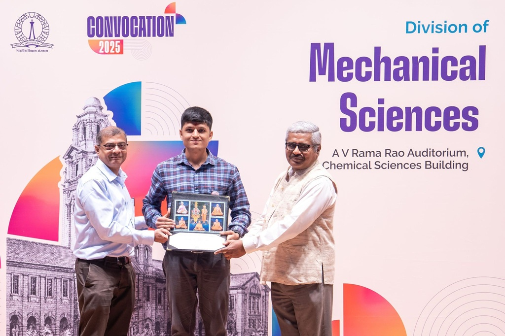

<!--more-->
Indian Institute of Science (IISc) Bengaluru held its Convocation-2025 on July 11, 2025 with Professor Manjul Bhargava, Professor of Mathematics at Princeton University as the Chief Guest.

## D3 Lab Students 

| **Name**         | **Degree conferred** |
|------------------|----------------------|
| [Gulshan Baghel](https://www.linkedin.com/in/gulshan-baghel-a94a3a2a4)   | MTech    |
| [Padmani Shivam B](https://www.linkedin.com/in/shivampadmani/)    | MTech    |

* with Dr. Akshay Joshi *(right)*")

