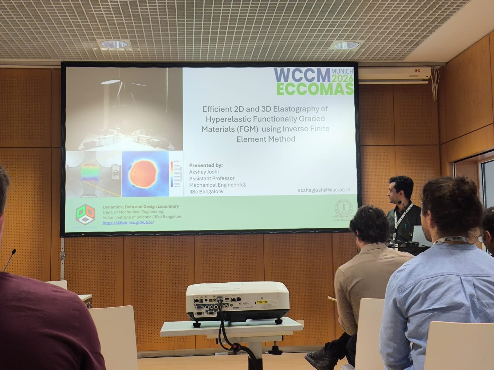
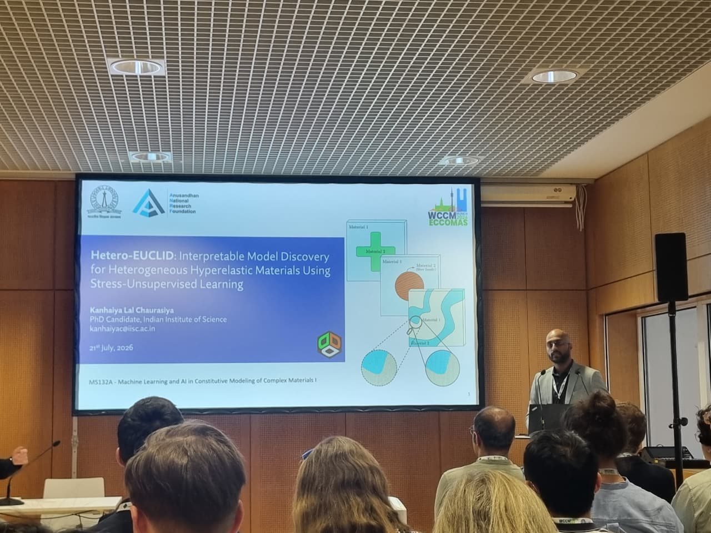
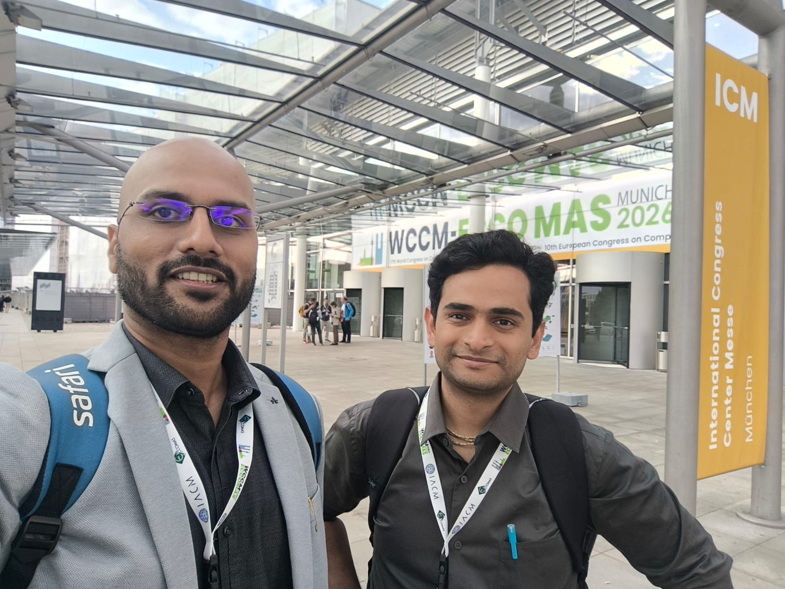
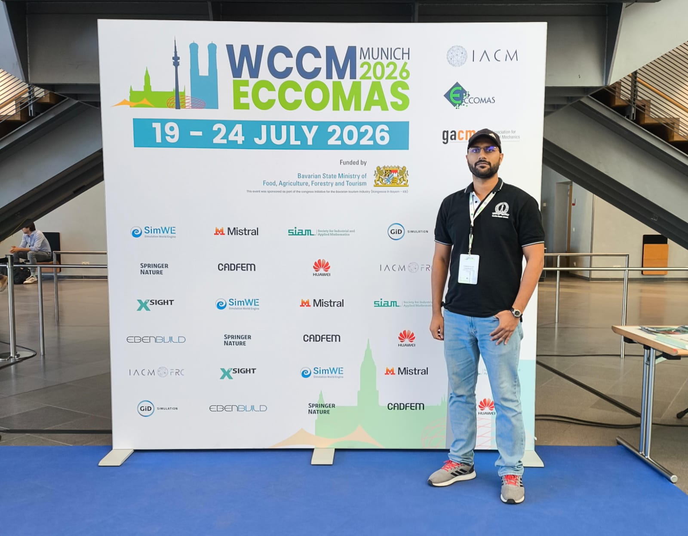

**WCCM-ECCOMAS 2026:** https://wccm-eccomas2026.org/

Representing the [Dynamics, Data and Design Lab](https://d3lab-iisc.github.io/), [Dr. Akshay Joshi](https://d3lab-iisc.github.io/author/dr.-akshay-joshi/) and [Kanhaiya Lal Chaurasiya](https://www.linkedin.com/in/ckanhaiya) delivered oral presentations at WCCM–ECCOMAS 2026 during the **MS132A: Machine Learning and AI in Constitutive Modeling of Complex Materials** technical session on the following topics:

{}
Efficient 2-D and 3-D Elastography of Hyperelastic Functionally Graded Materials using Inverse Finite Element Method

K. Chaurasiya , P. Patil , V. Halder , **A. Joshi***
{}

{}
Hetero-EUCLID: Interpretable Model Discovery for Heterogeneous Hyperelastic Materials Using Stress-Unsupervised Learning

**K. Chaurasiya*** , S. Dutta , S. Kumar , A. Joshi
{}

*, [Jeremy Bleyer](https://bleyerj.github.io/) *(middle)* and Akshay Joshi *(right)*")

